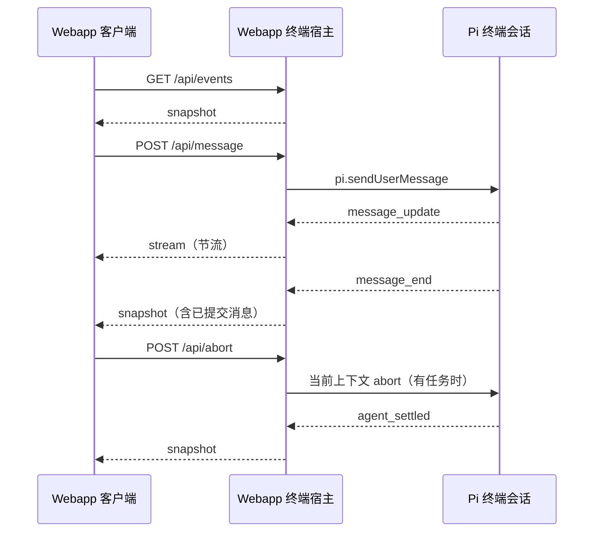

# Pi 桥接接口依据

证据固定到 [`chengzhiyi/pi-webapp@8b04675`](https://github.com/chengzhiyi/pi-webapp/commit/8b0467561a20368df8aeece3767bff598a877e20)（`pi-webapp` 0.1.52）。该版本声明 `@earendil-works/pi-coding-agent` 和 `@earendil-works/pi-ai` 的 peer 版本均为 **1.3.0**。下面以**正在运行的终端会话（TUI）**为准；Webapp 自己管理的 SDK 工作区会话不是同一个运行实例。

## 入口与运行方式

- [`package.json`](https://github.com/chengzhiyi/pi-webapp/blob/8b0467561a20368df8aeece3767bff598a877e20/package.json) 的 `pi.extensions` 指向 `./dist/extension.js`；[`scripts/build-extension.mjs`](https://github.com/chengzhiyi/pi-webapp/blob/8b0467561a20368df8aeece3767bff598a877e20/scripts/build-extension.mjs) 将 `src/adapters/pi/extension.ts` 打包成 Node ESM。适配器从 `pi-host.ts` 重导出 `default`，实际入口是 `piWeb(pi: ExtensionAPI, openPage = openWebPage)`，第二个参数在源码中有默认值。
- [终端宿主](https://github.com/chengzhiyi/pi-webapp/blob/8b0467561a20368df8aeece3767bff598a877e20/src/host/server/bootstrap/pi-host.ts#L329) 在扩展函数内用 `pi.on(...)` 注册监听；`session_start` 保存会话上下文。`pi.registerCommand("web", ...)` 让 `/web` 用命令上下文调用 `openWeb`；仅当 `PI_WEBAPP_AUTO_OPEN === "1"`、`ctx.mode === "tui"` 且尚未自动打开时，启动事件会走自动打开路径。
- Webapp 的 [`startBridge`](https://github.com/chengzhiyi/pi-webapp/blob/8b0467561a20368df8aeece3767bff598a877e20/src/host/server/transport/bridge.ts#L142) 是项目自己的本地 HTTP 服务，不是 Pi API。`GET /api/session` 取快照；`GET /api/events` 返回 NDJSON（不是 SSE），连入先写一条 `{ type: "snapshot", session }`，随后推送包括 `{ type: "stream", message }` 在内的事件。这里记录的是上游接线方式，不要求 pi-float 复刻其 HTTP 路由或协议。

上图显示上游默认 TUI 路径的消息同步与中断；中断也可发生在流式回复期间。

## 终端事件与投影

事件注册见 [`pi-host.ts:399–513`](https://github.com/chengzhiyi/pi-webapp/blob/8b0467561a20368df8aeece3767bff598a877e20/src/host/server/bootstrap/pi-host.ts#L399)，消息投影见 [`sessions/view.ts`](https://github.com/chengzhiyi/pi-webapp/blob/8b0467561a20368df8aeece3767bff598a877e20/src/host/server/sessions/view.ts)。

| Pi 事件 / 读取点 | 上游 TUI 行为 |
| --- | --- |
| `session_start` / `session_shutdown` | 启动发布当前会话快照；关闭清临时流、待处理交互和监听。`new`、`resume`、`fork`、`reload` 分支清空当前上下文后返回，真正退出才关闭 bridge。 |
| `agent_start` / `agent_end` / `agent_settled` | 都刷新快照；`agent_settled` 还清除临时流和诊断状态、调度待发队列。忙闲由 `ctx.isIdle()` 读取，TUI 快照还考虑 Webapp 自己的队列发送中状态。 |
| `message_update` | 只投影 `event.message.role === "assistant"`，把当前完整 `content` 变成临时消息 `id: "stream"`：`text.text`、`thinking.thinking`、`toolCall` 的 `name`、`id` 和 JSON 序列化后的 `arguments`。内存临时视图每次更新，对外推流最短间隔 60 ms。客户端应替换临时视图，不能把整个内容当增量拼接。 |
| `message_end` | 所有角色都会刷新快照；assistant 结束先清临时流并推 `message: null`。assistant 的 `stopReason === "error"` 会额外报告错误；`toolResult` 消息还交给诊断层。 |
| `tool_execution_start` / `tool_execution_end` | 接入宿主的工具诊断；不负责生成聊天记录中的 tool-call/tool-result。TUI 聊天里，调用来自 assistant `content` 的 `toolCall` 块；结果来自历史中 `role: "toolResult"` 的消息（投影为 `role: "tool"`），靠 `toolCallId` 关联，并携带 `toolName`、`isError`。 |
| `model_select` / `thinking_level_select` / `session_info_changed` | 刷新快照。模型读 `ctx.model`，标识为 `${provider}/${id}`，未选为 `null`；推理档位读 `ctx.thinkingLevel`，可用档位由 `getSupportedThinkingLevels(ctx.model)` 得出（无模型时为 `["off"]`）。 |
| token 统计（不是独立事件） | 历史 assistant 消息读 `message.usage`：`input`、`output`、`cacheRead`、`cacheWrite`、可选 `reasoning`、`totalTokens`、`cost.total`。上下文用量另读 `ctx.getContextUsage() ?? null`，投影类型为 `{ tokens: number \| null; contextWindow: number; percent: number \| null }` 或 `null`，不是对历史 token 求和。 |

`text_delta` / `thinking_delta` 不是这条 TUI 接线路径注册的 `pi.on` 事件。也不要把聊天记录的 `toolCall` / `toolResult` 消息投影与扩展的 `tool_call` / `tool_result` 钩子混淆：上游确实在[托管插件适配器](https://github.com/chengzhiyi/pi-webapp/blob/8b0467561a20368df8aeece3767bff598a877e20/src/host/server/plugins/hosted/agent-adapter.ts#L105) 监听 `tool_call` 以应用准入策略，但上述 TUI 路径不靠那两个钩子同步聊天。

## 初始历史与会话标识

`projectSession` 从 `ctx.sessionManager.getBranch()` 取**当前分支**，不是读取所有历史节点。`projectEntry` 仅保留 user、assistant、toolResult 和 `display` 为真的 `custom_message`（映射为 `notice`）；用条目的 `id` 和 `timestamp`，不是临时流的 `id`。会话 ID 来自 `getSessionId()`，工作目录来自 `ctx.cwd`，标题优先使用 `getSessionName()`，否则取首条用户消息的文本摘要。快照是断线重连时的基准，临时流不可当作已提交历史。

## 给正在运行的 Pi 发消息和中断

- **发送**：[`host.send` / `sendTui`](https://github.com/chengzhiyi/pi-webapp/blob/8b0467561a20368df8aeece3767bff598a877e20/src/host/server/bootstrap/pi-host.ts#L795) 先校验目标 `sessionId`，在真正发送时再次检查上下文。普通终端路径调用 `pi.sendUserMessage(content, { expandPromptTemplates: true, deliverAs })`；`content` 为字符串，或 text/image 块数组。空闲时可省略 `deliverAs`，忙时 Webapp 要求 `"steer"` 或 `"followUp"`，不允许把斜杠命令当追加提示词；忙时的 `followUp` 可先进 Webapp 自己的可编辑队列。`sendTui` 还为被替换的会话提供匹配 session ID 的 `replacementContext.sendUserMessage(...)` 分支，不是普通终端入口的必要条件。请求被接收不代表本轮回复完成。
- **中断**：[`host.abort`](https://github.com/chengzhiyi/pi-webapp/blob/8b0467561a20368df8aeece3767bff598a877e20/src/host/server/bootstrap/pi-host.ts#L817) 验证同一会话，空闲且队列未在发送则直接返回，否则标记诊断取消，用 `pi.appendEntry("pi-webapp/paused")` 写入 Webapp 自定义分支标记，然后调用当前 `ExtensionContext` 的 `abort()`。业务用的 paused 判断还检查 assistant 的 `stopReason === "aborted"`；自定义标记不是 Pi 中断的前置条件。`POST /api/abort` 返回的 202 仅表示请求已受理，最终状态从事件/快照确认。
- **切换模型**：[`host.setModel`](https://github.com/chengzhiyi/pi-webapp/blob/8b0467561a20368df8aeece3767bff598a877e20/src/host/server/bootstrap/pi-host.ts#L765) 校验会话、只在 `ctx.isIdle()` 时通过 `ctx.modelRegistry.find(provider, id)` 解析模型，并用 `getAvailable()` 核实可用性，再调用 `await pi.setModel(model)`；`false` 表示未配置认证。模型列表读取 `ctx.modelRegistry.getAvailable()`，并按 `ctx.scopedModels` 过滤（若设置）。
- **不混用 SDK 路径**：[`workspace-sessions.ts`](https://github.com/chengzhiyi/pi-webapp/blob/8b0467561a20368df8aeece3767bff598a877e20/src/host/server/sessions/workspace-sessions.ts#L384) 给宿主管理的会话调用 `session.prompt(text, { images, streamingBehavior, preflightResult })`，并用 `await session.abort()` 停止；不是给现有终端注入的接口。

pi-float 的桥接只以这里记录的终端接口为依据，不拦截工具；`packages/protocol` 的 DTO 是 pi-float 自己的数据约定，不暗示 Pi 原生提供会话注册或模块显隐接口。
